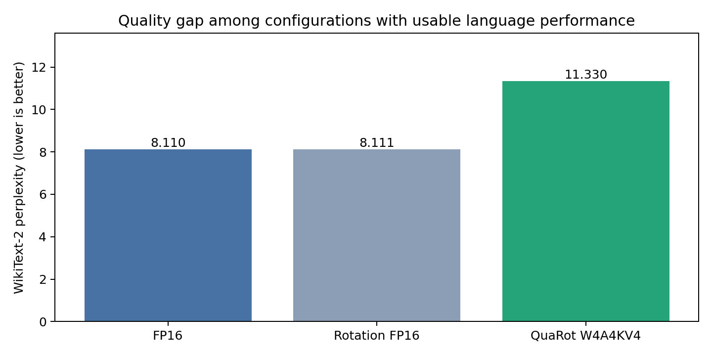
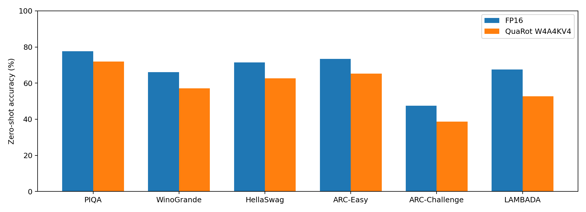
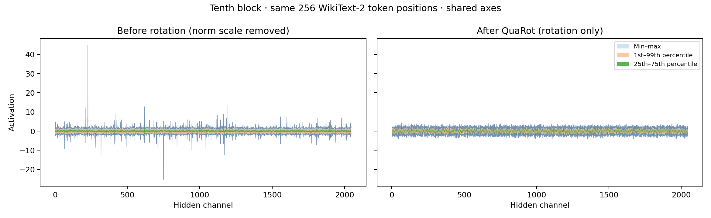

# QuaRot seminar reproduction

One model: **SmolLM2-1.7B base**, on RTX 4080 16 GB. See [REPORT.md](REPORT.md) for methodology, results and limitations.

## Measured results

We evaluated **SmolLM2-1.7B base on an RTX 4080 (16 GB)**. This reproduces the QuaRot method on a smaller model; the scores are not a replication of the paper's Llama results. W4A4KV4 denotes 4-bit weights, activations, keys and values, evaluated through floating-point quantization simulation.

### WikiText-2 perplexity

Full test evaluation uses 148 complete sequences of 2,048 tokens. Lower perplexity is better.

| Configuration | Perplexity ↓ |
|---|---:|
| FP16 baseline | 8.1103 |
| Rotation only (FP16) | 8.1113 |
| Unrotated W4A4KV4 control | 135,309,056.0000 |
| QuaRot W4A4KV4 | 11.3301 |

Rotation alone leaves perplexity nearly unchanged. QuaRot prevents the catastrophic collapse of the unrotated 4-bit control, but its perplexity remains **39.70% above FP16**.



### Full six-task zero-shot accuracy

All **21,848 evaluation examples** were scored with zero few-shot examples. Values are percentages; the mean is the unweighted arithmetic mean across tasks. `acc_norm` is length-normalized accuracy, following the upstream evaluation convention.

| Task | Examples | Metric | FP16 (%) ↑ | QuaRot (%) ↑ | Change (pp) |
|---|---:|---|---:|---:|---:|
| PIQA | 1,838 | acc_norm | 77.64 | 71.98 | -5.66 |
| WinoGrande | 1,267 | acc | 66.06 | 57.14 | -8.92 |
| HellaSwag | 10,042 | acc_norm | 71.42 | 62.69 | -8.73 |
| ARC-Easy | 2,376 | acc_norm | 73.48 | 65.32 | -8.16 |
| ARC-Challenge | 1,172 | acc_norm | 47.53 | 38.65 | -8.87 |
| LAMBADA OpenAI | 5,153 | acc | 67.59 | 52.78 | -14.81 |
| **Mean** | — | — | **67.29** | **58.09** | **-9.19** |

QuaRot retains **86.34%** of FP16 mean accuracy.



### Effect on activation outliers

A controlled comparison on the same normalized activation tensor (256 token positions at the tenth block's FFN input) isolates the geometric effect of rotation:

| Measure | Before rotation | After rotation |
|---|---:|---:|
| Maximum magnitude / RMS ↓ | 44.91 | 4.36 |
| Normalized INT4 reconstruction MSE ↓ | 0.310818 | 0.015851 |
| Signal-to-quantization-noise ratio ↑ | 5.07 dB | 18.00 dB |

The local reconstruction error falls by **19.6×**. This single-layer measurement explains the reduction in outliers; end-to-end quality is measured separately above.



These results cover one model and one calibration/rotation seed. Packed INT4 inference throughput and memory savings were not measured. See the [full report](REPORT.md) and [machine-readable summary](figures/summary.json) for methodology and limitations.

## Repository contents and setup

Git includes the Markdown report, figures, scripts, dependency lock, compact measured results and validation records. Model weights, datasets, tensor dumps, raw per-example benchmark outputs, logs and the local environment are excluded. These files remain on the original machine. The compact six-task scores and split counts are retained in `references/full-task-validation.json` and `figures/summary.json`.

Fetch the pinned upstream code and apply the compatibility changes before running:

```bash
git clone https://github.com/spcl/QuaRot.git QuaRot
git -C QuaRot checkout 5008669b08c1f11f9b64d52d16fddd47ca754c5a
git -C QuaRot apply ../references/upstream-changes.patch
python3.10 -m venv .venv
.venv/bin/python -m pip install --upgrade pip
.venv/bin/python -m pip install -r requirements-lock.txt
```

The lock targets Linux, Python 3.10 and the recorded CUDA/PyTorch environment; its native Hadamard wheel is platform specific. Download the model below and prefetch task datasets with `.venv/bin/python scripts/prefetch_tasks.py` before the offline zero-shot script. Regenerating every plot requires the excluded local activation tensors and raw benchmark dumps, produced by the experiments. Published plots and compact measurements can be viewed without those artifacts.

## Run

The dedicated environment is `.venv` (Python 3.10). Exact resolved dependencies are in `requirements-lock.txt`; upstream code is in `QuaRot/`. Run commands from this directory.

```bash
bash scripts/run_suite.sh
bash scripts/run_zero_shot.sh
.venv/bin/python scripts/plot_results.py
```

The suite skips configurations with existing `metrics.json`. To intentionally rerun a configuration, move its result directory first. Zero-shot runs require the checkpoint saved by the QuaRot perplexity run. They use all examples in the six benchmark evaluation splits. The harness selects batch sizes automatically under a GPU memory limit; both configurations use SDPA attention and zero few-shot examples.

Model source: `HuggingFaceTB/SmolLM2-1.7B` at revision `effd688a12921b4cc83e3312b6feb579f70f9c71`. Download with `hf download` and `--local-dir models/SmolLM2-1.7B`. Use the same revision when reproducing.

## Outputs

- `results/<configuration>/metrics.json`: measured perplexity, timing, GPU allocation, configuration.
- `results/<configuration>/zero_shot.json`: full harness output, including task definitions, scores and per-example results.
- `results/<configuration>/ffn_input.pt`: first 256 token positions, tenth decoder block, FFN input before activation quantization.
- `results/rotation_only/rotation_matrix.pt`: actual global rotation for the paired geometric test.
- `data/`: tokenized WikiText-2 calibration/evaluation inputs from quantization runs, with hashes in their metrics.
- `figures/`: plots and quantitative `summary.json` generated from available completed runs.
- `logs/`: process output. `logs/suite.log` records run transitions.

## Interpretation

These are floating-point simulations of quantization. Perplexity/GPTQ used the exact PyTorch FWHT fallback. The final QuaRot task run uses the official prebuilt fast Hadamard CUDA kernel, validated bitwise against the reference at this model’s dimensions. Set HADAMARD_BACKEND=reference or native to select the backend. Do not present its runtime or floating-point tensor storage as real INT4 inference speed or memory savings. KV quantization is emulated on attention tensors; no packed cache deployment is benchmarked.

The RMSNorm scales are fused into adjacent weights for rotation. Hook plots therefore include this equivalent reparameterization. `isolated_rotation` in `figures/summary.json` quantizes the same normalized tensor before and after the saved orthogonal transform to isolate the geometric effect.

SmolLM2 ties embeddings to the output head. The loader makes an identical copy before independently transforming the two matrices. Quantization settings otherwise follow the paper, adapting KV group size from 128 to this model's 64-element attention heads. Differences from upstream are retained in `references/upstream-changes.patch`.
