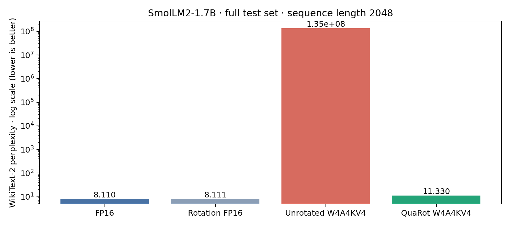
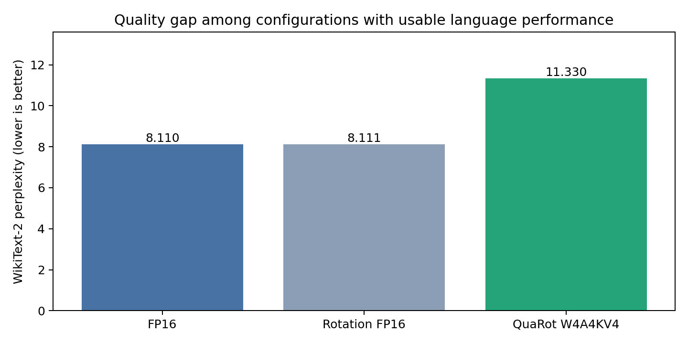
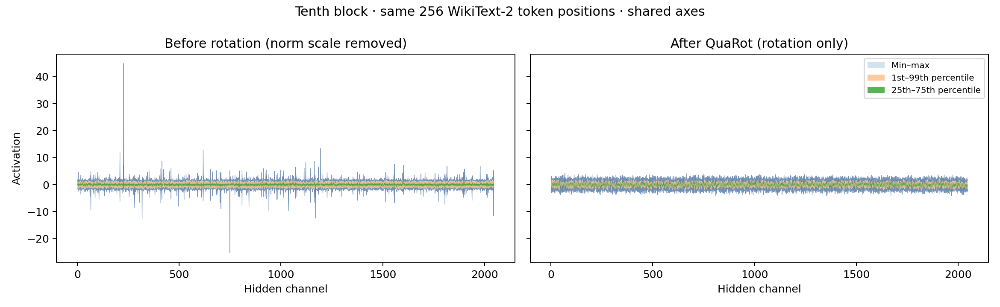
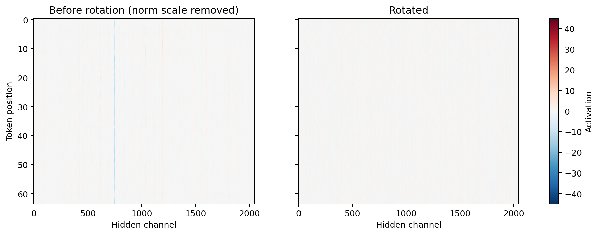
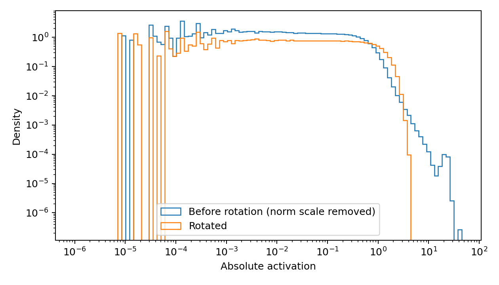
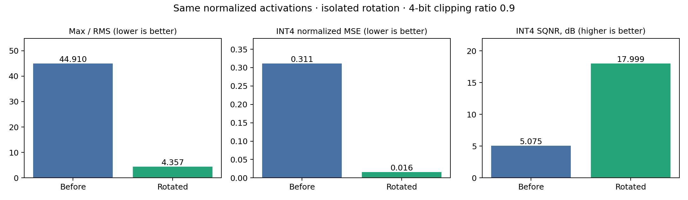
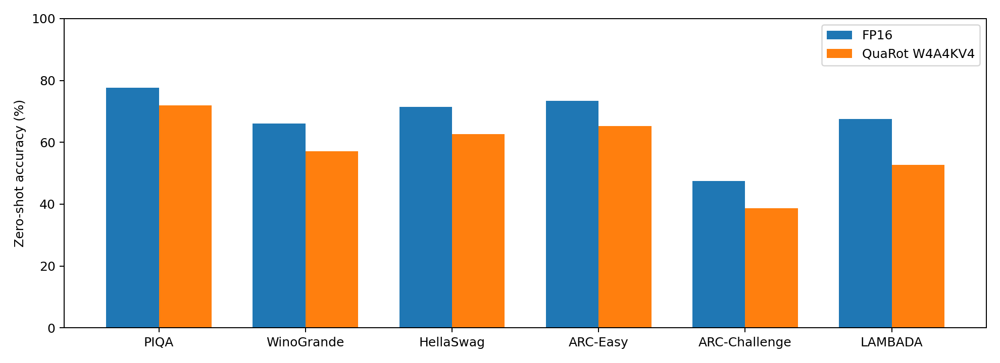

# QuaRot reproduction on SmolLM2-1.7B

Status: All four perplexity configurations and both full six-task zero-shot evaluations completed.

## Scope

At the user's request, use one smaller model: **HuggingFaceTB/SmolLM2-1.7B**, pretrained base checkpoint. Revision: `effd688a12921b4cc83e3312b6feb579f70f9c71`. Llama-2-7B weights and run artifacts were deleted when the user changed model. This is a reproduction of the QuaRot method on a different model, not a replication of the paper's numerical model results.

Sources: [published NeurIPS 2024 paper](https://papers.nips.cc/paper/2024/file/b5b939436789f76f08b9d0da5e81af7c-Paper-Conference.pdf), [official code](https://github.com/spcl/QuaRot), [model](https://huggingface.co/HuggingFaceTB/SmolLM2-1.7B). Code pinned at `5008669b08c1f11f9b64d52d16fddd47ca754c5a`; local changes recorded in references/upstream-changes.patch.

## What is being reproduced

QuaRot spreads activation magnitudes across channels using orthogonal Hadamard transforms. Matching transformations are absorbed into weights so the full-precision function is preserved before quantization. For a linear layer, `W x = (W Qᵀ)(Q x)` when `Qᵀ Q = I`. Norm preservation allows large channel outliers to become more evenly distributed, reducing the step size needed for low-bit quantization.

The unrotated configuration is our own matched ablation. We assess function preservation with the rotation-only run, quantization quality with end-to-end perplexity and zero-shot accuracy, and the geometric mechanism with captured activations.

## Hardware and feasibility

RTX 4080 with 16,376 MiB VRAM; approximately 15 GiB host RAM; 4 GiB swap. SmolLM2 has hidden width 2048, FFN width 8192, 24 blocks and 32 attention/KV heads, each of dimension 64. These dimensions support the official Hadamard transforms. Smaller SmolLM2 variants have odd attention-head counts unsupported by the official across-head transform.

FP16 checkpoint weights require approximately 3.2 GiB. Untying the shared embedding/output head for safe independent rotation adds about 0.19 GiB. GPTQ's two 128 × 2048 × 2048 FP16 activation buffers require 2 GiB. FP16 KV cache at batch 1 and 2048 tokens would require 0.375 GiB; cache is disabled for perplexity. These estimates exclude working tensors and allocator reserve; actual peaks will be measured.

## Protocol

Full WikiText-2 test perplexity: 148 complete sequences (303,104 input tokens and 302,956 scored next-token predictions), sequence length 2048, concatenating documents with two newlines, dropping the final partial block. Calibration: 128 WikiText-2 training sequences, length 2048, seed 0. GPTQ symmetric per-output-channel weights with the official code’s default clipping search (error exponent 2.4); symmetric per-token activations, clip ratio 0.9; asymmetric keys/values clipped at 0.95. KV group size is **64**, adapted to this model's head dimension rather than the paper models' 128. Weights, activations, keys and values are quantized to 4 bits; embeddings/head and other operations follow the upstream full-precision exceptions.

Runs: FP16 baseline; FP16 rotation only; QuaRot W4A4KV4 with GPTQ; strict unrotated W4A4KV4 with identical settings. The strict unrotated control disables upstream's otherwise automatic Q/K rotation. The rotation-only run checks the full upstream preprocessing pipeline before interpreting quantized results.

Evaluate zero-shot PIQA, WinoGrande, HellaSwag, ARC-Easy, ARC-Challenge, LAMBADA OpenAI and their arithmetic mean. Record each task's acc/acc_norm convention. Use full evaluation splits; the completion state and measured scores appear below.

The paper also reports single-block prefill speedup and packed KV-cache peak-memory savings on RTX 3090. These kernel metrics are **not measured in this accuracy reproduction**. Simulator elapsed time and PyTorch allocation peaks below describe feasibility, not the paper’s INT4 performance claims.

## Implementation and reproducibility

Dedicated Python 3.10 environment with PyTorch 2.2.1, Transformers 4.38.0, datasets 2.17.1 and accelerate 0.27.2. Online Hadamard transforms use FP32 and return to FP16. Perplexity and GPTQ runs used a local numerical PyTorch FWHT fallback. The final QuaRot zero-shot run uses the official prebuilt [fast-hadamard-transform CUDA wheel](https://github.com/Dao-AILab/fast-hadamard-transform/releases/tag/v1.0.4.post1), version 1.0.4.post1 for Torch 2.2, CUDA 12.2, Python 3.10 and the matching C++ ABI. It runs with this environment’s CUDA runtime without a local compiler. Validation against the reference backend gave bitwise-identical FP32 outputs at dimensions 32, 64, 2048 and 8192, including the non-contiguous across-head input layout; checks are saved in references/native-hadamard-validation.json. Its involution check on random GPU vectors had maximum absolute error below 5e-7. No real INT4 throughput or packed-memory savings can be inferred from this floating-point simulation.

The loader explicitly uses FP16. Perplexity/GPTQ use eager attention with preserved cache positions; the full zero-shot harness uses SDPA attention for practical runtime, identically for baseline and QuaRot. Full task splits use the harness’s automatic batch-size selection (`auto:4`) under a fixed GPU allocator limit, with zero few-shot examples. The tied embedding/head are separated with an identical weight copy before rotation. The official preprocessing also subtracts each embedding row’s mean; we retain that code path. Consequently, “rotation only” here includes embedding centering and normalization-scale fusion as well as the orthogonal rotations. Exact algebraic function preservation applies to the orthogonal transformation itself; the measured full-pipeline logits differ, while aggregate perplexity is nearly unchanged. The replacement RMSNorm epsilon is 1e-5, matching this model’s configuration. Repeated garbage collection and GPU-cache clearing were removed from the grouped activation-quantization hot path; this changes allocation management, not quantization arithmetic. The upstream module scan tolerates uninitialized RoPE cache properties in the pinned Transformers version; evaluator dispatch and GPTQ checks recognize the Llama architecture independently of repository name. The model source is local and requires no gated access. Experiment configurations, metrics, logs, environment versions and activation samples are retained. Tokenized calibration inputs and their hash were saved for the control; hash recording was added after the QuaRot process started, so its input hash is unavailable. Both configurations use the same documented training data, sampling function, sample count and seed.

## Reporting and visualization

Report measured perplexity, absolute and relative perplexity changes, per-task and mean accuracy, percentage-point differences and accuracy retention. Keep published reference values separate: the paper's Llama-2-7B baseline/QuaRot perplexities are 5.47/6.10 and mean accuracies 69.82%/65.64%; these are not targets for SmolLM2.

Capture the same first 256 evaluation token positions at FFN input of the tenth block, before activation quantization. For plotted distributions, divide the original tensor by its saved RMSNorm scale so both sides use the equivalent scale-free normalization. Produce shared-axis channelwise percentile envelopes, heatmaps and absolute-magnitude distributions before/after rotation. Quantify max/RMS, quantization normalized MSE and SQNR. Raw post-norm hook tensors include a normalization-parameterization difference because scales are fused into adjacent weights. Preserve those raw statistics separately; the plotted comparison removes the baseline scale. Also compare a directly rotated baseline tensor to isolate the geometric effect.

The measured results and figures below are generated from completed runs. One calibration/rotation seed and one layer’s 256-token activation sample limit the scope of the conclusions.

<!-- MEASURED_RESULTS -->
## Measured results

| Configuration | WikiText-2 PPL ↓ | Change from FP16 | Elapsed (s) | Peak allocated VRAM (GiB) |
|---|---:|---:|---:|---:|
| FP16 | 8.1103 | +0.0000 | 66.9 | 3.62 |
| Rotation FP16 | 8.1113 | +0.0010 | 118.4 | 3.62 |
| Unrotated W4A4KV4 | 135309056.0000 | +135309047.8897 | 453.0 | 4.75 |
| QuaRot W4A4KV4 | 11.3301 | +3.2198 | 906.9 | 3.63 |

Timings describe floating-point accuracy simulation, including setup, and are not INT4 inference speedups. GPU figures are peak PyTorch allocations, excluding display/other-process memory.

The QuaRot perplexity run used the original per-call allocator cleanup; the control used the optimized cleanup placement. These elapsed times therefore also reflect implementation and scheduling differences and must not be compared as algorithm speed benchmarks.

The unrotated W4A4KV4 control collapsed (PPL 135,309,056). QuaRot prevented this collapse, but its PPL remains 39.7% above FP16. Perplexity can exceed vocabulary size when the model assigns very small probabilities to correct tokens; this result is finite, not numerical overflow.

Rotation-only check on 32 token positions: relative logit L2 error 0.025668, maximum absolute error 1.8359, top-1 agreement 96.9%.

On the same normalized activation tensor, rotation changes max/RMS from 44.91 to 4.36, normalized INT4 reconstruction MSE from 0.310818 to 0.015851, and SQNR from 5.07 to 18.00 dB. This controlled local reconstruction test isolates rotation from RMSNorm scale fusion; it is distinct from end-to-end quantized model accuracy.

| Task | Examples | Metric | FP16 (%) | QuaRot (%) | Difference (pp) |
|---|---:|---|---:|---:|---:|
| piqa | 1838 | acc_norm,none | 77.64 | 71.98 | -5.66 |
| winogrande | 1267 | acc,none | 66.06 | 57.14 | -8.92 |
| hellaswag | 10042 | acc_norm,none | 71.42 | 62.69 | -8.73 |
| arc_easy | 2376 | acc_norm,none | 73.48 | 65.32 | -8.16 |
| arc_challenge | 1172 | acc_norm,none | 47.53 | 38.65 | -8.87 |
| lambada_openai | 5153 | acc,none | 67.59 | 52.78 | -14.81 |

Mean accuracy: FP16 67.29%, QuaRot 58.09%; retention 86.34%.

